# Vokabeltrainer

Ein selbst gehosteter Vokabeltrainer fürs Handy, gemacht für Englischkurse: Vokabeln pro Unterrichtsstunde, Aussprache von der Lehrkraft **und** einer KI-Stimme, Wiederholung nach festem Plan, Sprech- und Diktatübungen, tägliche Erinnerung und Widget. Alles läuft auf deinem eigenen Server – Spracherkennung (Whisper) und Sprachausgabe (Piper) laufen lokal, ohne Cloud-KI.

<p align="center">
  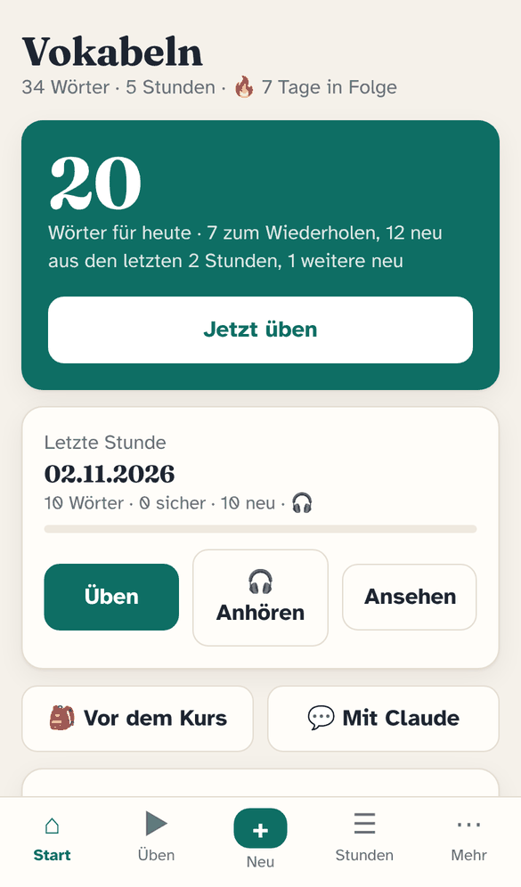
  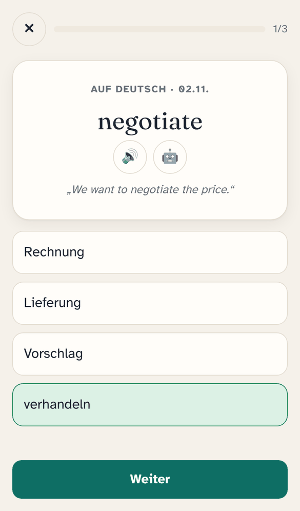
  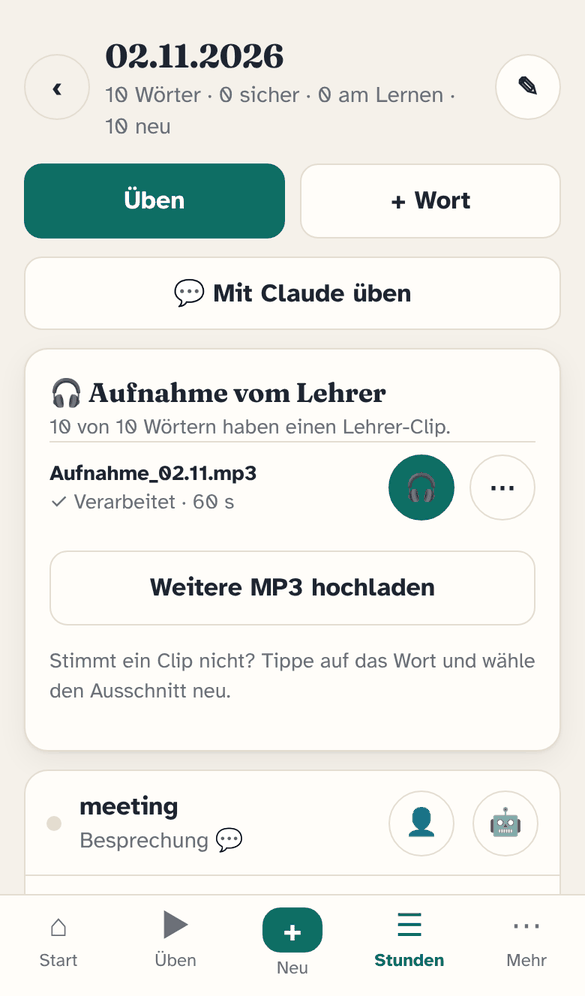
  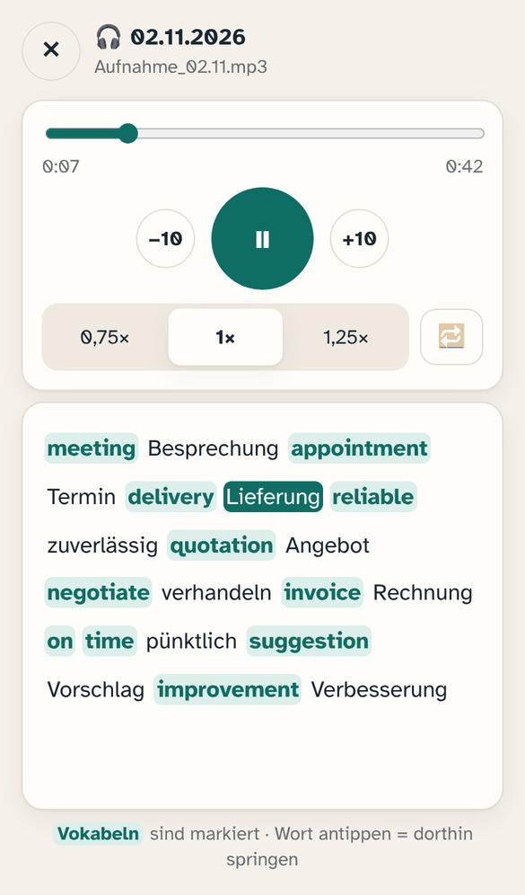
</p>

> Alle Bilder zeigen erfundene Beispielvokabeln.

**Inhalt:** [Funktionen](#funktionen) · [Excel-Vorgaben](#vorgaben-für-die-excel-tabelle) · [MP3-Vorgaben](#vorgaben-für-die-lehrer-aufnahme-mp3) · [Installation](#voraussetzungen) · [Datenschutz](#datenschutz-und-recht--wenn-andere-deine-instanz-nutzen)

---

## Funktionen

### Startseite & tägliche Runde


- **„Jetzt üben“** stellt jeden Tag eine gemischte Runde zusammen:
  1. alle **neuen Wörter der beiden neuesten Stunden** (ohne Tageslimit),
  2. abwechselnd mit den **fälligen Wiederholungen** aus allen früheren Stunden,
  3. danach **weitere neue Wörter** aus älteren Stunden bis zum **Tageslimit** (5/10/20/ohne Limit, unter *Mehr*).
- **Serie** (🔥 Tage in Folge), **Verlauf** der letzten 4 Wochen und **Gesamtstand** (sicher / am Lernen / neu).
- **Letzte Stunde** direkt üben oder die Lehrer-Aufnahme anhören.
- **🎒 Vor dem Kurs:** die letzte Stunde plus die Wörter, die in den letzten zwei Wochen falsch waren.
- **Schwierige Wörter üben:** Wörter mit vielen Fehlern.

<br clear="right">

### Übungsarten

<p>
  
  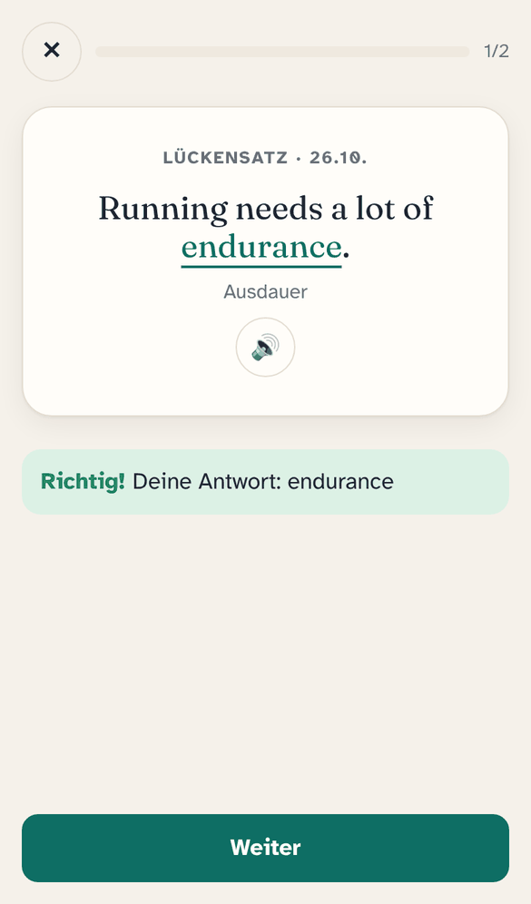
  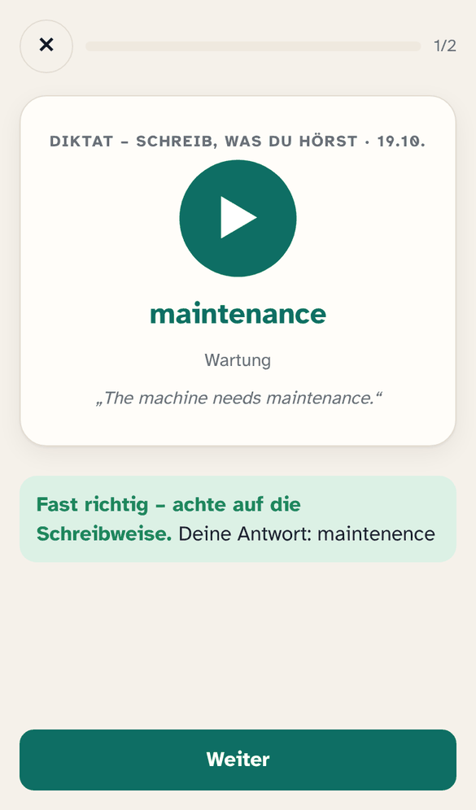
  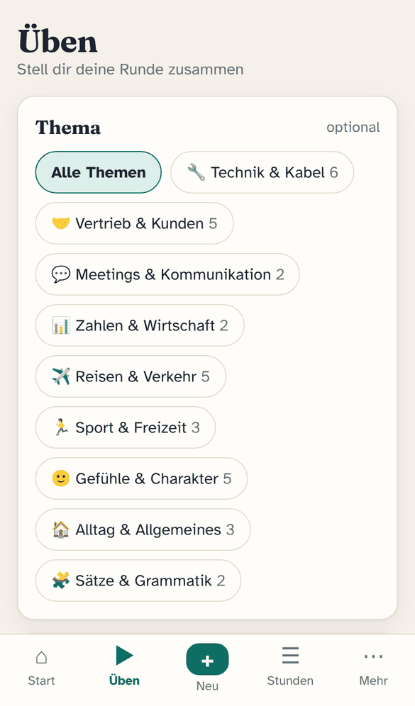
</p>

| Übung | So geht's |
|---|---|
| **Gemischt** | Die App wählt passend zum Lernstand: neue Wörter erst als Auswahl und Hören, später Schreiben, Lückensatz und Diktat |
| **Karten** | Karteikarte aufdecken, selbst bewerten: *Nochmal / Schwer / Gewusst* |
| **Auswahl** | Vier Antworten, eine richtige |
| **Schreiben** | Übersetzung eintippen – kleine Tippfehler werden toleriert, Zahlwörter = Ziffern („five“ = „5“) |
| **Hören** | Wort hören, Bedeutung auswählen |
| **Lückensatz** | Beispielsatz mit Lücke ergänzen |
| **Diktat** | Wort hören und auf Englisch schreiben |
| **🎙️ Sprechen** | Wort ins Mikrofon sagen – Whisper prüft auf dem Server, ob es verstanden wird |
| **🎧 Anhören** | Die ganze Lehrer-Aufnahme als Playlist (siehe unten) |

- Auswahl nach **Stunden**, **Themen**, *Fällig + neu / Alle / Schwierige / Nur neue*, Richtung *DE → EN / EN → DE / beides* und Anzahl.
- Nach jeder Antwort: Lösung, **Beispielsatz** und Aussprache – weiter geht es mit dem **Weiter**-Knopf (oder automatisch, einstellbar).
- Gleiche Wörter in mehreren Stunden haben einen **gemeinsamen Lernstand** und werden pro Runde nur einmal abgefragt.
- Wiederholung nach dem **Leitner-Prinzip**: 1 → 3 → 7 → 14 → 30 → 60 → 120 Tage.

### Stunden & Vokabeln

<p>
  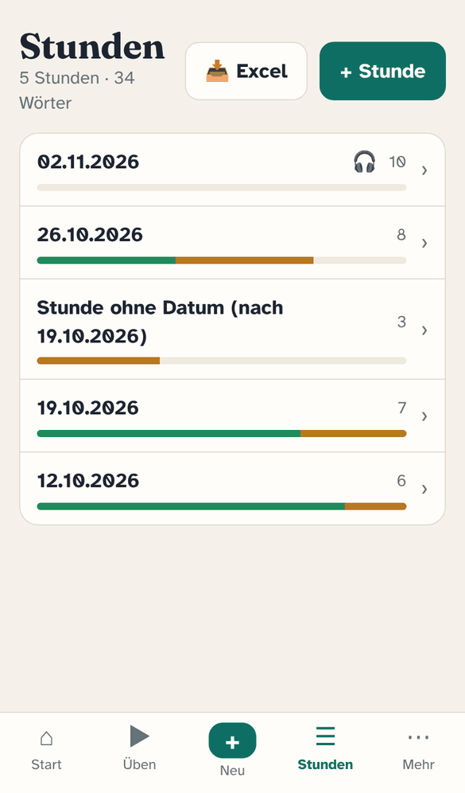
  
  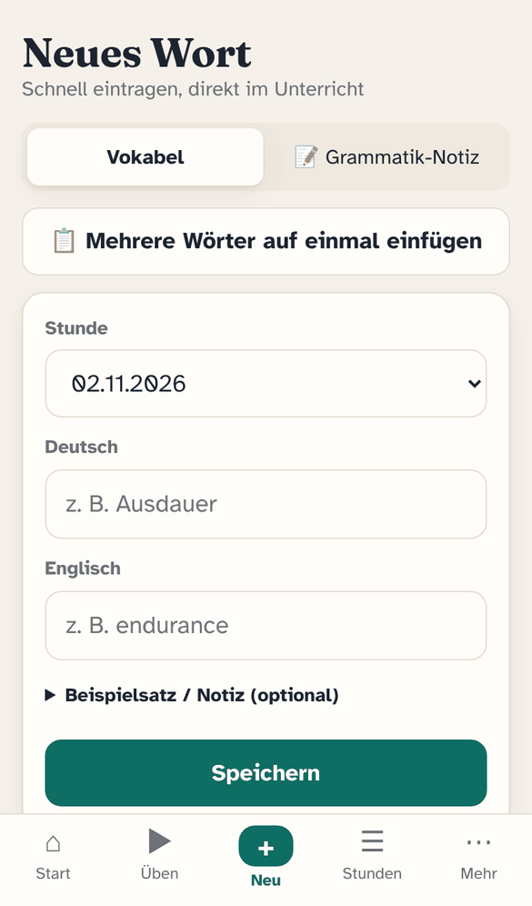
  
</p>

- Jede **Stunde** hat Datum, Wörter, Lehrer-Aufnahmen und Fortschrittsbalken; Stunden ohne Datum werden nach der vorherigen einsortiert.
- **Neues Wort** in Sekunden eintragen – mit Hinweis, falls es das Wort schon gibt. Optional Beispielsatz (Vokabel in `[ ]`) und Notiz.
- **📋 Mehrere Wörter auf einmal:** Liste einfügen (`Englisch = Deutsch`, `Englisch ; Deutsch`, `Englisch - Deutsch` oder zwei Excel-Spalten), Vorschau prüfen, übernehmen. Klappt auch mit einem Foto der Tafel über Claude.
- **📝 Grammatik-Notizen** (z. B. „since vs. for“) erscheinen beim Üben als Karteikarte.
- **📥 Excel-Import** mit Vorschau, Korrektur und Claude-Prüfung – siehe [Vorgaben](#vorgaben-für-die-excel-tabelle).
- **Export/Import** des kompletten Stands als JSON (Sicherung oder Umzug).

### Lehrer-Aufnahme: Wort für Wort

<p>
  
  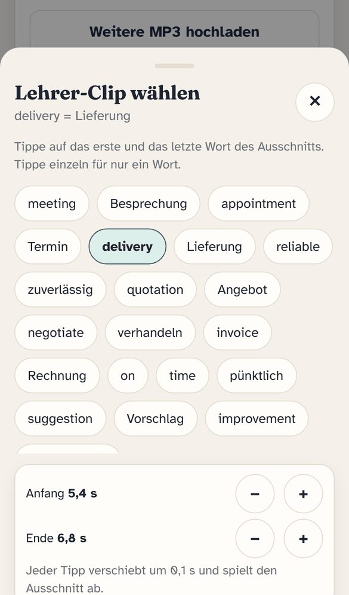
  
</p>

- MP3 der Lehrkraft hochladen – **Whisper** erstellt eine Abschrift mit Zeitstempeln und schneidet für jede Vokabel den passenden **Lehrer-Clip** heraus (auch für Wörter, die später ergänzt werden).
- Clip passt nicht? Wort antippen → **Ausschnitt wählen**: erstes und letztes Wort in der Abschrift antippen, mit ±0,1 s feinjustieren.
- **🎧 Anhören:** ganze Aufnahme mit **Mitlesen** (das gesprochene Wort ist markiert, Vokabeln hervorgehoben), Tempo 0,75×/1×/1,25×, ±10 s, Schleife, mehrere Stunden als Playlist – läuft auch bei **gesperrtem Bildschirm** mit Steuerung auf dem Sperrbildschirm.
- Lehrer-Clip und KI-Stimme werden beim Üben **auf dieselbe Lautstärke** gebracht.

### KI-Stimme, Themen & Claude

<p>
  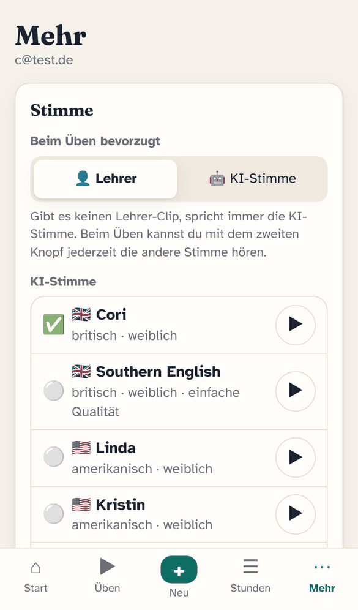
  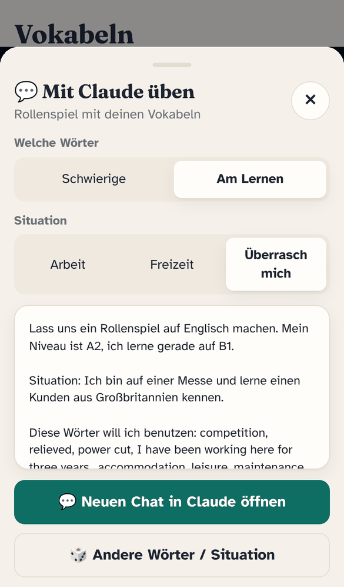
  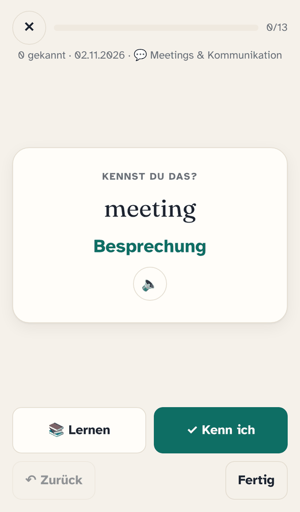
</p>

- **KI-Stimme (Piper)** für jedes Wort, erzeugt auf deinem Server. 7 frei lizenzierte Stimmen zur Wahl (britisch/amerikanisch, weiblich/männlich) mit **Hörprobe**. Beim Üben bevorzugt *Lehrer* oder *KI* – der zweite Knopf spielt jeweils die andere Stimme.
- **🏷️ Themen** (Technik & Kabel, Vertrieb & Kunden, Meetings, Zahlen & Wirtschaft, Reisen, Sport & Freizeit, Gefühle & Charakter, Gesellschaft, Alltag, Sätze & Grammatik): beim Üben filtern; neue Stunden per **„Themen holen“** über Claude zuordnen.
- **⚡ Kenn ich schon?** Große Wortbestände schnell vorsortieren: *Kenn ich* (kommt erst in 30 Tagen zur Kontrolle) oder *Lernen*. Mit „Zurück“ für Fehltipps.
- **💬 Mit Claude üben:** öffnet ein Rollenspiel auf claude.ai mit deinen Wörtern (aus der Stunde, schwierige, zuletzt falsche …) und einer Situation aus Arbeit oder Freizeit. Optional direkt in deinem Claude-Projekt.
- **✍️ Sätze holen:** Claude schreibt Beispielsätze für Wörter ohne Satz – Antwort einfügen, fertig.

Claude wird **nur geöffnet, wenn du einen Claude-Knopf antippst**; die App selbst schickt nichts an KI-Dienste.

### Erinnerung & Widget

<p>
  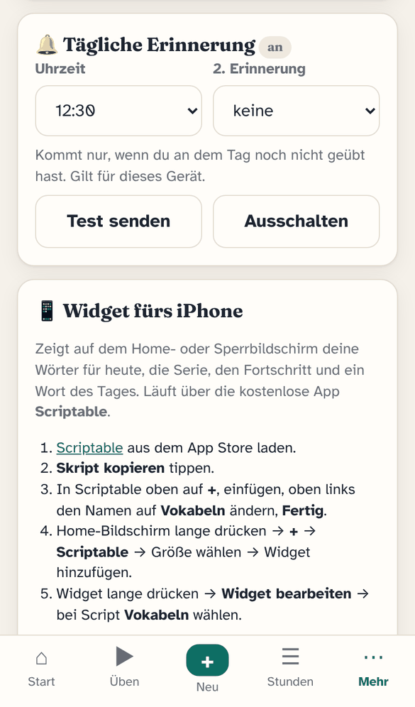
  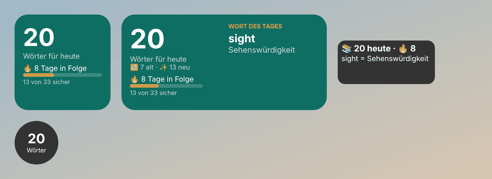
</p>

- **🔔 Tägliche Erinnerung** als Push-Mitteilung zur gewählten Uhrzeit (optional eine zweite) – **nur, wenn du an dem Tag noch nicht geübt hast**. Mit Anzahl der Wörter, Serie und Wort des Tages. Auf dem iPhone: App über *Teilen → Zum Home-Bildschirm* anlegen und von dort öffnen (iOS 16.4+).
- **📱 Widget** für Home- und Sperrbildschirm über die kostenlose App *Scriptable*: Wörter für heute, Serie, Fortschritt, **Wort des Tages**. Antippen öffnet die Web-App (über einen Kurzbefehl mit `webapp://…`) oder den Browser. Einrichtung Schritt für Schritt unter *Mehr → Widget*.

---

## Vorgaben für die Excel-Tabelle


Der Import liest `.xlsx`, `.xls` und `.xlsm`. Einfach immer die **aktuelle Gesamtdatei** laden – Vorhandenes wird erkannt und übersprungen.

**Reiter = Stunde.** Der Reitername bestimmt das Datum:

| Reitername | wird zu |
|---|---|
| `2026.03.02` oder `2026..03.02` | 02.03.2026 |
| `02.03.2026` | 02.03.2026 |
| `2024.29.04` (Tag und Monat vertauscht) | 29.04.2024 – wird erkannt |
| alles andere, z. B. `Tabelle1` | **Stunde ohne Datum** nach der vorherigen Stunde |

**Spalten:**

| Spalte A | Spalte B | Spalte C (optional) |
|---|---|---|
| Deutsch | Englisch | Beispielsatz mit der Vokabel in `[ ]`, z. B. `We meet at the [trade fair].` |

Sonderfälle:
- Ist **B leer, aber C gefüllt**, gilt C als Englisch (eine Nummerierung wie `1.` in A wird entfernt) – praktisch für Satzlisten.
- **Kopfzeilen** (`Deutsch`, `German`), Zeilen wie `SATZBAU …` ohne Englisch und Excel-Fehler (`#NAME?`, `#N/A`, `0`) werden übersprungen.
- **Leere Reiter** werden ignoriert.
- **Unvollständige Zeilen** (nur Deutsch oder nur Englisch) zeigt die Vorschau markiert an – ergänzen oder weglassen.

**Vorschau vor dem Import:**
- pro Reiter *neue Stunde* oder *vorhanden*, Anzahl neuer und schon vorhandener Wörter;
- jedes Wort lässt sich **direkt korrigieren**, abwählen oder per **„✍️ Mit Claude prüfen“** auf Tippfehler und fehlende Übersetzungen prüfen; jede Korrektur merkt sich das Excel-Original, damit beim nächsten Import nichts doppelt kommt;
- Reiter ohne Datum werden der passenden Stunde **über den Inhalt** zugeordnet; ist das nicht eindeutig, fragt die App nach (*„bitte prüfen“*: vorhandene Stunde oder neue Stunde).
- Für wiederkehrende Tippfehler einer Kurs-Excel gibt es optional eine Korrekturliste – siehe [unten](#optionale-korrekturliste-für-eine-kurs-excel).

<br clear="right">

## Vorgaben für die Lehrer-Aufnahme (MP3)

| | |
|---|---|
| **Formate** | MP3, M4A, MP4 (Ton), WAV, OGG |
| **Größe** | bis 100 MB pro Datei (ca. 1–2 Stunden MP3) |
| **Pro Stunde** | beliebig viele Aufnahmen, z. B. eine pro Unterrichtsteil |
| **Dauer der Auswertung** | je nach CPU einige Minuten pro Aufnahme (Whisper *small*); der Status steht in der Stunde |

So klappt das Zuordnen am besten:
- Die Lehrkraft spricht jede Vokabel **deutlich auf Englisch** – gern gefolgt vom deutschen Wort oder einem Beispielsatz. Die **Reihenfolge ist egal**, die Zuordnung läuft über den Inhalt.
- **Kurze Pausen** zwischen den Wörtern, wenig Hintergrundgeräusche, Handy nah an der Lehrkraft.
- **Mehrere Bedeutungen** wie „labour, work“ dürfen nacheinander gesprochen werden – der Clip umfasst dann beide.
- Die Wörter der Stunde sollten **vor oder nach** dem Hochladen eingetragen werden – später ergänzte Wörter bekommen ihren Clip automatisch nachträglich.
- Stimmt ein Clip nicht: Wort antippen → *Ausschnitt wählen*. Ganze Aufnahme neu auswerten: in der Stunde ⋯ neben der Aufnahme → *Neu auswerten* (von Hand gewählte Clips bleiben).
- Werden englische Wörter oft falsch erkannt, in der `.env` `WHISPER_LANGUAGE=en` setzen oder `WHISPER_MODEL=medium` (genauer, langsamer).

---

## Voraussetzungen

- Ein Linux-Server oder eine VM bzw. ein LXC mit **Docker** (Docker Compose v2)
- **CPU mit AVX** (prüfen: `grep -q avx /proc/cpuinfo && echo ok`)
- ca. **3 GB RAM**, **10 GB Speicher** (Modelle ca. 1 GB plus deine Aufnahmen)
- Für den Zugriff von unterwegs: Reverse Proxy mit HTTPS, z. B. Nginx Proxy Manager, Caddy oder Traefik, eventuell zusätzlich ein Tunnel

Bei einem Proxmox-LXC unter *Options → Features* **nesting** und **keyctl** aktivieren.

## Installation

```bash
git clone https://github.com/<dein-konto>/vokabeltrainer.git
cd vokabeltrainer
cp .env.example .env
nano .env                 # E-Mail + Passwörter für dich und den Admin, Betreiber für die Datenschutzseite
docker compose up -d --build
docker compose logs -f worker
```

Beim **ersten Start** lädt der Worker die Modelle herunter: Whisper *small* ca. 500 MB, je Piper-Stimme ca. 110 MB. Danach erzeugt er die KI-Stimme für alle Wörter.

Test im lokalen Netz: `http://<server-ip>:8090`, anmelden mit `APP_USER_EMAIL` / `APP_USER_PASSWORD`.

## Reverse Proxy (Beispiel Nginx Proxy Manager)

Proxy Host auf `http://<server-ip>:8090`, **Websockets** an, SSL an. Unter *Advanced*:

```nginx
client_max_body_size 100M;
proxy_buffering off;          # Live-Aktualisierung (Server-Sent Events)
proxy_read_timeout 600s;

# Admin-Bereich von außen sperren – nur im lokalen Netz über http://<server-ip>:8090/_/
location /_/ { deny all; }
location /api/collections/_superusers/ { deny all; }
```

Bei anderen Proxys gilt dasselbe: Uploads bis 100 MB erlauben, kein Puffern, `/_/` und `/api/collections/_superusers/` von außen sperren.

**Aufs Handy:** Die Adresse in Safari oder Chrome öffnen, dann *Teilen* → **Zum Home-Bildschirm**.

## Betrieb

| Was | Wie |
|---|---|
| Update | `git pull && docker compose up -d --build` (`.env` und `data/` bleiben erhalten). Die App zeigt danach „Neue Version … Neu laden“ |
| Backup | Ordner `data/` sichern – Datenbank, Aufnahmen, Modelle und der Push-Schlüssel (`data/models/vapid_private.pem`). Zusätzlich in der App *Mehr → Exportieren* |
| Admin-Oberfläche | `http://<server-ip>:8090/_/` (nur lokal) |
| Passwort ändern | In `.env` ändern → `docker compose up -d` |
| Version | In der App unter *Mehr* ganz unten |
| Widget | Ruft `/api/heute?key=…` ab – der Reverse Proxy muss diesen Pfad durchlassen (Standard) |

### Optionale Korrekturliste für eine Kurs-Excel

Enthält die Excel eurer Lehrkraft immer dieselben Tippfehler, kann der Import sie automatisch berichtigen. Lege dazu `pocketbase/pb_public/known_fix.json` an. Die Datei ist nicht Teil des Repos:

```json
[["Excel-Deutsch", "Excel-Englisch", "richtiges Deutsch", "richtiges Englisch"]]
```

## Feinabstimmung (`.env`)

- `WHISPER_MODEL`: `base` ist schneller, `medium` genauer (braucht ca. 5 GB RAM). Standard ist `small`.
- `WHISPER_LANGUAGE`: leer lassen (automatisch). Werden englische Wörter schlecht erkannt, `en` probieren.
- `PIPER_VOICE_GB` / `PIPER_VOICE_US`: Standardstimme je Sprache (`en_GB-cori-high`, `en_US-ljspeech-high`). Die Stimme lässt sich bequemer in der App unter *Mehr → KI-Stimme* wählen. Eigene Stimmen nur nach Prüfung der MODEL_CARD – Stimmen auf Lessac-Basis sind nur für Forschung lizenziert und werden vom Worker ersetzt.
- `APP_TZ`: Zeitzone für die Tagesübersicht (Standard `Europe/Berlin`).
- `PIPER_LENGTH_SCALE`: `1.2` = langsamer und deutlicher.

## Datenschutz und Recht – wenn andere deine Instanz nutzen

- **Datenschutzseite:** `/legal/datenschutz.html`, verlinkt beim Login und unter *Mehr*. In der `.env` `APP_OPERATOR_NAME`, `APP_OPERATOR_CONTACT` und gegebenenfalls `APP_PROXY_PROVIDER` (z. B. `Cloudflare`) eintragen und neu starten. Prüfe, ob der Text zu deinem Betrieb passt. Er ist eine Vorlage und keine Rechtsberatung.
- **Keine Verbindungen zu Dritten:** Schriften und Skripte liegen lokal, ohne Tracking und ohne Analyse. Claude wird nur geöffnet, wenn man einen Claude-Knopf antippt.
- **Datensparsam:** Sprachaufnahmen beim Üben werden nach ca. einer Stunde gelöscht, Server-Protokolle nach 7 Tagen. Selbstregistrierung ist abgeschaltet, Konten legt der Betreiber an.
- **Gemeinsamer Datenbestand:** Alle Konten einer Instanz sehen dieselben Stunden und denselben Lernstand. Für getrennte Lernstände betreibt jede Person ihre eigene Instanz.
- **Kursinhalte gehören nicht ins Repo:** Vokabellisten und Aufnahmen der Lehrkraft sind deren Werk. Teilt sie nur mit ihrer Zustimmung. Ins Repo und in Forks gehören sie nie, `data/` ist per `.gitignore` ausgeschlossen.
- **Lizenzen:** siehe `THIRD_PARTY_NOTICES.md` und `/legal/lizenzen.html`.

## Fehlersuche

```bash
docker compose ps
docker compose logs --tail 100 worker
docker compose logs --tail 100 pocketbase
```

- **Aufnahme bleibt bei „Wartet auf Verarbeitung“:** Der Worker läuft nicht oder lädt noch Modelle → Log ansehen.
- **`Illegal instruction` im Worker-Log:** Die CPU hat kein AVX.
- **App lädt nicht über die Domain, im LAN aber schon:** Reverse Proxy bzw. Tunnel prüfen.
- **Keine Erinnerung auf dem iPhone:** Die App muss vom Home-Bildschirm geöffnet sein (nicht in Safari/Chrome). Unter *Mehr → Tägliche Erinnerung → Test senden* prüfen; im Worker-Log steht „Erinnerung verschickt“.
- **Widget öffnet Chrome statt der App:** unter *Mehr → Widget* „Web-App“ wählen, den angezeigten Kurzbefehl anlegen, Skript neu kopieren und das Widget einmal entfernen und neu hinzufügen.
- **Kein Ton bei der ersten Karte (iPhone):** einmal irgendwo tippen – iOS gibt Ton nur nach einer Berührung frei.

## Lizenz

Der Code steht unter der [MIT-Lizenz](LICENSE). Mitgelieferte Fremdsoftware, Schriften und Stimmen haben eigene Lizenzen, siehe [THIRD_PARTY_NOTICES.md](THIRD_PARTY_NOTICES.md).
